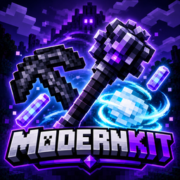

# ⚒️ ModernKit

**Bringing newer Minecraft items into older Minecraft versions.**

Ever wanted to experience some of Minecraft's newer items without leaving your favorite older versions behind?

**ModernKit** aims to bridge that gap by introducing items and equipment inspired by newer Minecraft updates into older versions, bringing new possibilities to your gameplay.

Whether you're smashing enemies with a Mace, launching Wind Charges, charging into battle with a Spear, or mining bedrock in survival, ModernKit brings more tools and equipment to your Minecraft world.

---

## ✨ What's Included?

### ⚔️ Weapons & Combat

- **Mace** — Fall from a height and land a powerful smash attack. The longer the fall, the more damage you deal. A successful smash cancels your fall damage, knocks back nearby mobs, and plays impact effects.
- **Spears** — Six variants: wooden, stone, golden, iron, diamond, and netherite. Jab with a quick attack, or hold to charge into enemies. Includes first- and third-person animations.
- **Lunge Enchantment** — A spear-exclusive enchantment (levels I to III).
- **Mob Kabob Advancement** — Hit five mobs with a single charge attack.

### 🌪️ Wind & Breeze Items

- **Wind Charge** — A throwable projectile with its own sounds.
- **Breeze Rod** — Used to craft Wind Charges and the Mace, and to repair the Mace.
- **Heavy Core** — The crafting component at the heart of the Mace.

### ⛏️ Tools

- **Bedrock Pickaxe** — Mine bedrock in survival mode! Bedrock drops itself when mined.

### 🌈 Rainbow Set

The most powerful gear in ModernKit, with animated rainbow icons.

- **Rainbow Sword** — Massive damage and a very fast attack speed.
- **Rainbow Pickaxe** — Breaks almost anything, obsidian included, nearly instantly.
- **Rainbow Armor** (Helmet, Chestplate, Leggings, Boots) — Maximum protection and toughness, and full knockback immunity when you wear the whole set.
- **Rainbow Ingot** — The crafting and repair material for the set.
- Every Rainbow item is fireproof, enchantable, and has enormous durability.

---

## 🧰 Crafting Recipes

| Item | Recipe |
|---|---|
| Bedrock Pickaxe | 3 Bedrock on top, 2 Sticks below |
| Breeze Rod | Blaze Rod + Phantom Membrane |
| Heavy Core | Netherite Ingot surrounded by 4 Obsidian |
| Mace | Heavy Core above a Breeze Rod |
| Wind Charge | 1 Breeze Rod makes 4 |
| Rainbow Ingot | Nether Star + Netherite Ingot + Diamond Block (makes 4) |
| Rainbow Sword / Pickaxe / Armor | Crafted from Rainbow Ingots in the standard tool and armor shapes |

---

## 🔧 Fixes & Improvements

- Bedrock now properly drops itself when mined with the Bedrock Pickaxe.
- The Mace no longer performs sword-style sweep attacks.
- Optimized the Wind Charge texture for better loading.
- Old builds no longer get in the way of new releases.

---

## 📦 Compatibility

- **Minecraft:** 1.16.5 (Fabric)
- **Requires:** Fabric API
- **Works with:** Sodium and Iris

---

## 🛠️ Development & Testing

ModernKit's features are tested to ensure they work as intended. However, bugs and unexpected issues can still happen.

If you encounter a bug, experience unexpected behavior, or have suggestions for improvements, please let us know!

## 🐛 Found a Bug?

Your feedback helps make ModernKit better.

**Discord:** `@.porel.`

Feel free to reach out if you encounter any issues or have ideas for future additions.

---

**ModernKit — More possibilities. More items. One Minecraft.**